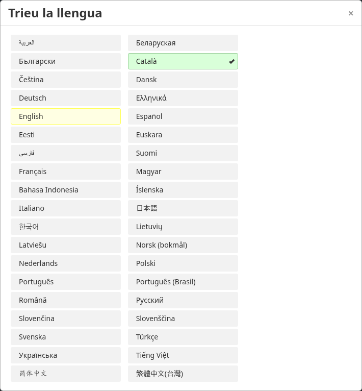

# Catalan translation

Catalan (`ca`, Català) translation for SnappyMail. A complete linguistic pass
was applied on 2026-10-16; see [review notes](REVIEW.md). Further corrections
from Catalan-speaking users are welcome.

Existing translations were adapted from RainLoop's official Catalan resources:
https://github.com/RainLoop/rainloop-webmail/tree/9bf8fa5b63d7e6871ee533126a7e1b1c85ee45b5/rainloop/v/0.0.0/app/localization

SnappyMail-specific strings were translated for this contribution. Preserve the
original MIT copyright and permission notice in `LICENSE-RainLoop` when reusing
the adapted RainLoop texts. The translation includes user, admin and static
messages, plus the relative-time fallback resource.

Native language selector on a test login page (no authenticated session or mail):

